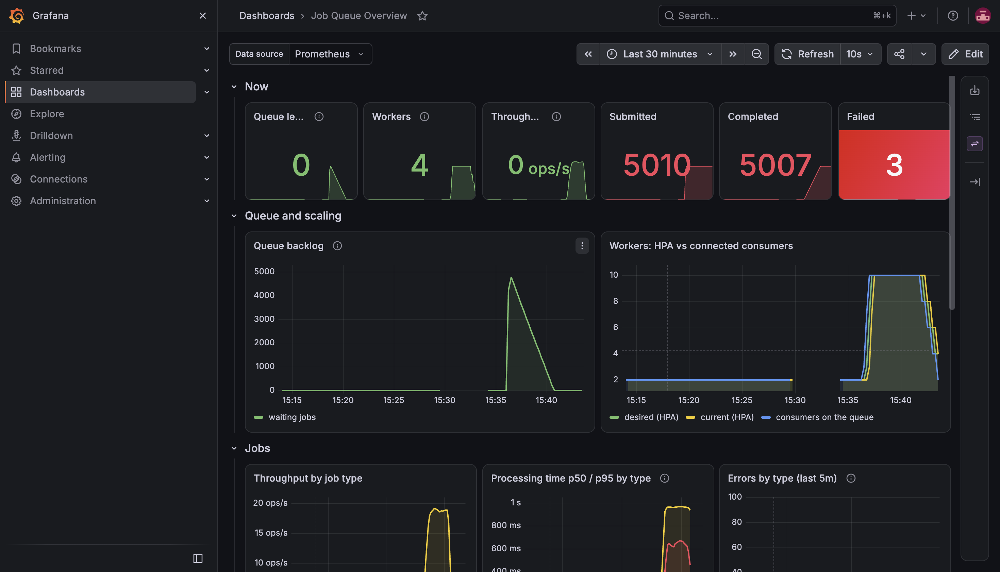
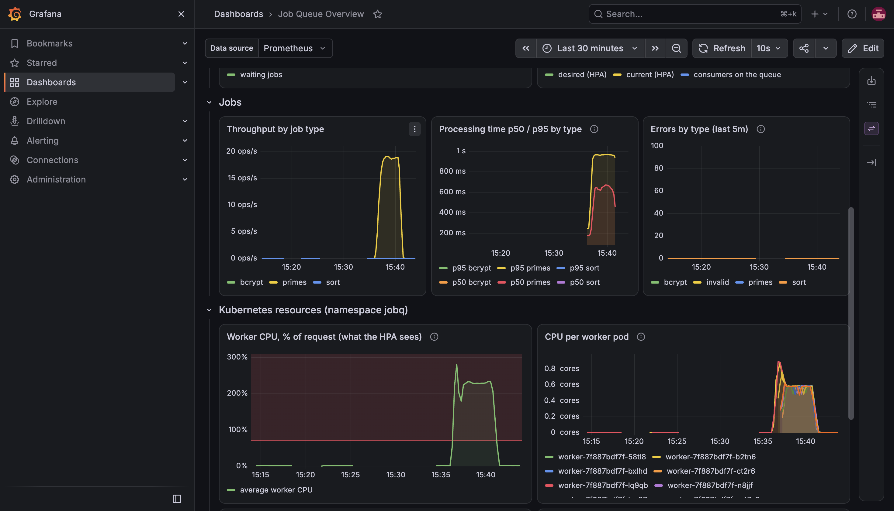
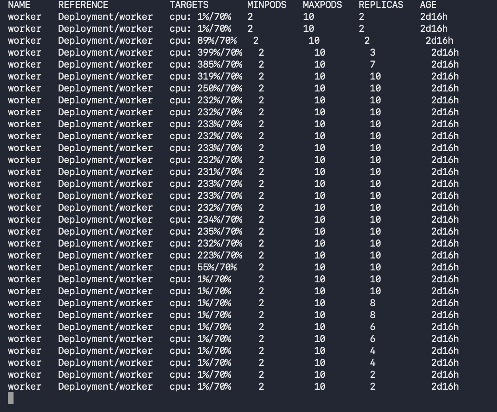

# Scalable Job Queue on Kubernetes

Node.js microservices that process CPU-heavy jobs through a queue, deployed on Kubernetes (Minikube). Workers scale automatically with a Horizontal Pod Autoscaler, and Prometheus and Grafana show the system under a stress test.

## Architecture

```
client ──► Ingress (NGINX) ──► Service A: gateway ──► RabbitMQ queue "jobs" ──► Service B: worker (2–10 pods, HPA)
           /submit, /status        │                                                 │
                                   ▼                                                 ▼
                                 Redis  ◄──────── job status, results, totals ──────┘
                                   ▲
                                   └── Service C: stats  (/stats, /metrics)

Prometheus scrapes the worker and stats /metrics; Grafana shows the dashboard.
```

| Service | Responsibility | Endpoints |
|---|---|---|
| **A: gateway** | validates jobs, stores them in Redis, publishes them to the queue, returns the job id (202) | `POST /submit`, `GET /status/:id`, `/healthz`, `/readyz` |
| **B: worker** | consumes jobs, runs the CPU work, saves the result in Redis. **Horizontally scaled.** | `/metrics`, `/healthz`, `/readyz` |
| **C: stats** | reports system-wide job counts, average time and queue length | `GET /stats`, `/metrics`, `/healthz`, `/readyz` |

Job types (worker): `primes` (count primes up to `limit`, default 100,000), `bcrypt` (10 rounds), `sort` (generate and sort 100,000 integers).

Metrics:
- Worker: `jobs_processed_total`, `job_processing_time_seconds` (histogram), `job_errors_total`, all labelled by job `type`.
- Stats: `total_jobs_submitted`, `total_jobs_completed`, `total_jobs_failed`, `queue_length`, `queue_consumers`.

### Design decision: RabbitMQ for the queue, Redis for state

The assignment describes a Redis queue. This project uses **RabbitMQ as the queue** and **Redis for job state, results and totals**:
- RabbitMQ gives acknowledgements and redelivery, so a job is never lost if a worker dies mid-job.
- Each worker takes one job at a time (`prefetch(1)`), so every new pod added by the HPA starts working immediately.
- Redis keeps what it's best at: fast lookups for `/status/:id`, and atomic counters (`HINCRBY`) shared by all pods.

## Repository layout

```
services/gateway, services/worker, services/stats   Node.js + TypeScript services, each with its own Dockerfile
k8s/                    Kubernetes manifests (kustomize): namespace, ConfigMap, Secret, Deployments,
                        Services, Ingress, HPA, RabbitMQ, Redis
k8s/monitoring/         Helm values for kube-prometheus-stack, ServiceMonitors, Grafana dashboard JSON
loadtest/               ApacheBench stress test
docker-compose.yml      local development (RabbitMQ + Redis; services behind the "app" profile)
```

## Prerequisites

Docker Desktop, [Minikube](https://minikube.sigs.k8s.io/), kubectl, [Helm](https://helm.sh/), and `ab` (ApacheBench, preinstalled on macOS). Node.js 24 only for local development.

## Deploy on Minikube

**1. Start the cluster and add-ons:**

```bash
minikube start --driver=docker --cpus=6 --memory=6g
minikube addons enable ingress
minikube addons enable metrics-server
```

Optional but recommended, so the HPA reacts in about 20 s instead of about a minute. Minikube resets this on every `minikube start`, so re-run it after each start:

```bash
kubectl -n kube-system patch deploy metrics-server --type=json \
  -p='[{"op":"replace","path":"/spec/template/spec/containers/0/args/4","value":"--metric-resolution=15s"}]'
```

**2. Build the images inside Minikube** (no registry needed):

```bash
minikube image build -t jobq-gateway:v2 services/gateway
minikube image build -t jobq-worker:v3  services/worker
minikube image build -t jobq-stats:v2   services/stats
```

**3. Deploy the application** (namespace `jobq`):

```bash
kubectl apply -k k8s
kubectl config set-context --current --namespace=jobq
kubectl get pods -w        # wait until all are 1/1 Running
```

**4. Deploy Prometheus and Grafana with Helm** (namespace `monitoring`):

```bash
helm repo add prometheus-community https://prometheus-community.github.io/helm-charts
helm repo update
helm install prometheus prometheus-community/kube-prometheus-stack --version 92.10.0 \
  --namespace monitoring --create-namespace \
  -f k8s/monitoring/kube-prometheus-stack.values.yaml --wait
kubectl apply -k k8s/monitoring
```

The second command adds:
- **ServiceMonitors** for the worker and stats services: Prometheus scrapes their pods' `/metrics` every 15 s. This is the scrape config for Services B and C.
- **The Grafana dashboard** "Job Queue Overview", loaded automatically from `k8s/monitoring/dashboards/jobq-overview.json`.

**5. Open access from your Mac** (keep each one running in its own terminal):

```bash
minikube tunnel                                                        # Ingress at http://127.0.0.1 (asks for your password)
kubectl port-forward -n monitoring svc/prometheus-grafana 3002:80     # Grafana at http://localhost:3002
kubectl port-forward svc/stats 3001:3001                              # stats at http://localhost:3001
```

Grafana login: `admin` / `jobq-local-only`.

Without `minikube tunnel`, the Ingress is also reachable with `kubectl port-forward -n ingress-nginx svc/ingress-nginx-controller 8080:80`, at `http://localhost:8080`.

## Try it

```bash
curl -s -XPOST http://127.0.0.1/submit -H 'content-type: application/json' \
  -d '{"type":"primes","payload":{"limit":100000}}'
# {"success":true,"data":{"id":"<job-id>","status":"queued"}}

curl -s http://127.0.0.1/status/<job-id>
# {"success":true,"data":{"status":"completed","result":{"limit":100000,"primeCount":9592}, ...}}

curl -s localhost:3001/stats
# {"success":true,"data":{"jobs":{"submitted":1,"completed":1,"failed":0,"pending":0},
#  "averageProcessingTimeMs":4.2,"queue":{"length":0,"consumers":2}}}
```

## Kubernetes setup

| Requirement | Implementation |
|---|---|
| Deployments for A, B, C and Redis | `k8s/apps/*.yaml`, `k8s/infra/redis.yaml` (plain YAML), plus RabbitMQ in `k8s/infra/rabbitmq.yaml` |
| A exposed via Ingress + LoadBalancer | `k8s/apps/ingress.yaml` routes only `/submit` and `/status`; the gateway Service is `type: LoadBalancer` |
| B, C as ClusterIP | `k8s/apps/worker.yaml`, `k8s/apps/stats.yaml` |
| ConfigMaps | `k8s/config/configmap.yaml` (shared settings); credentials in `k8s/config/secret.yaml` |
| HPA: B, 2 → 10 pods at CPU > 70% | `k8s/apps/worker-hpa.yaml` |
| Probes, resources | every app has an init container (waits for RabbitMQ and Redis), startup/readiness/liveness probes, and CPU/memory requests and limits |

## Stress test

The assignment's command, `ab -n 5000 -c 200 http://<ingress-ip>/submit`, sends GET requests, but `/submit` is a POST endpoint. The script adds a JSON body:

```bash
./loadtest/stress-test.sh
# = ab -r -n 5000 -c 200 -p loadtest/submit-primes.json -T application/json http://127.0.0.1/submit
```

Each request submits `{"type":"primes","payload":{"limit":2000000}}` (about 0.2 s of CPU per job). Watch the scaling while it runs:

```bash
kubectl get hpa worker -w
kubectl get pods -l app.kubernetes.io/name=worker -w
```

### Results (Minikube, 6 CPUs / 6 GB)

| | |
|---|---|
| Requests | 5,000 accepted in 25.7 s (195 req/s), **0 failed** |
| Queue backlog | peaked at about 4,490 jobs |
| Autoscaling | 2 → 6 workers at about 20 s, → 10 at about 45 s |
| Throughput | about 4.6 jobs/s with 2 workers → about 19.5 jobs/s with 10 |
| Backlog drained | after about 4.5 min: **5,000 / 5,000 completed, 0 failed** |
| Scale-down | 10 → 2 workers over about 2 min after the queue emptied |

### Screenshots

#### Queue backlog and worker autoscaling



#### Job throughput, processing time and worker CPU



#### HPA scaling decisions (`kubectl get hpa worker -w`)



### Observations on scaling

1. **The queue absorbed the burst.** The gateway accepted all 5,000 jobs in 26 s while the workers needed about 4.5 minutes; the difference waited safely in RabbitMQ.
2. **The HPA reacted in about 20 s** and reached the maximum of 10 workers in about 45 s. The desired count follows `ceil(current × CPU utilisation / 70%)`, with CPU measured against each worker's 250m request.
3. **Throughput rose about 4× from 2 to 10 workers, then hit the machine's limit.** With 10 workers, each got about 0.55 of a core: the node's 6 CPUs were full. More pods wouldn't help on one machine; a real cluster would add nodes (Cluster Autoscaler).
4. **Individual jobs got slower under load** (p95 about 0.2 s → about 1.0 s) because cores were shared, while total throughput went up.
5. **The gateway was the submission bottleneck:** at 200 concurrent clients each request waited about 1 s. More gateway replicas would raise the submit rate.
6. **Scale-down lost nothing.** Removed workers receive SIGTERM, finish and acknowledge their current job, then exit.

## Monitoring

The Grafana dashboard "Job Queue Overview" (`k8s/monitoring/dashboards/jobq-overview.json`) has four rows:
- **Now:** queue length, workers, throughput, and jobs submitted, completed and failed.
- **Queue and scaling:** the backlog over time; HPA desired and current replicas vs consumers on the queue.
- **Jobs:** throughput, p50/p95 processing time and errors, each by job type.
- **Kubernetes resources:** worker CPU as a % of request (with the 70% HPA target), CPU per worker pod, CPU by service, and memory by pod.

To check scraping, port-forward Prometheus and open Status → Targets; `serviceMonitor/jobq/worker` and `serviceMonitor/jobq/stats` should be `UP`:

```bash
kubectl port-forward -n monitoring svc/prometheus-kube-prometheus-prometheus 9090:9090
```

## Local development

```bash
docker compose up -d                                   # RabbitMQ (5673, UI 15673) and Redis (6380)
cd services/<gateway|worker|stats>
cp .env.example .env && npm install && npm run dev
```

To run all three services in containers too: `docker compose --profile app up -d --build`.

## Cleanup

```bash
helm uninstall prometheus -n monitoring
kubectl delete -k k8s
minikube stop          # or: minikube delete
```
